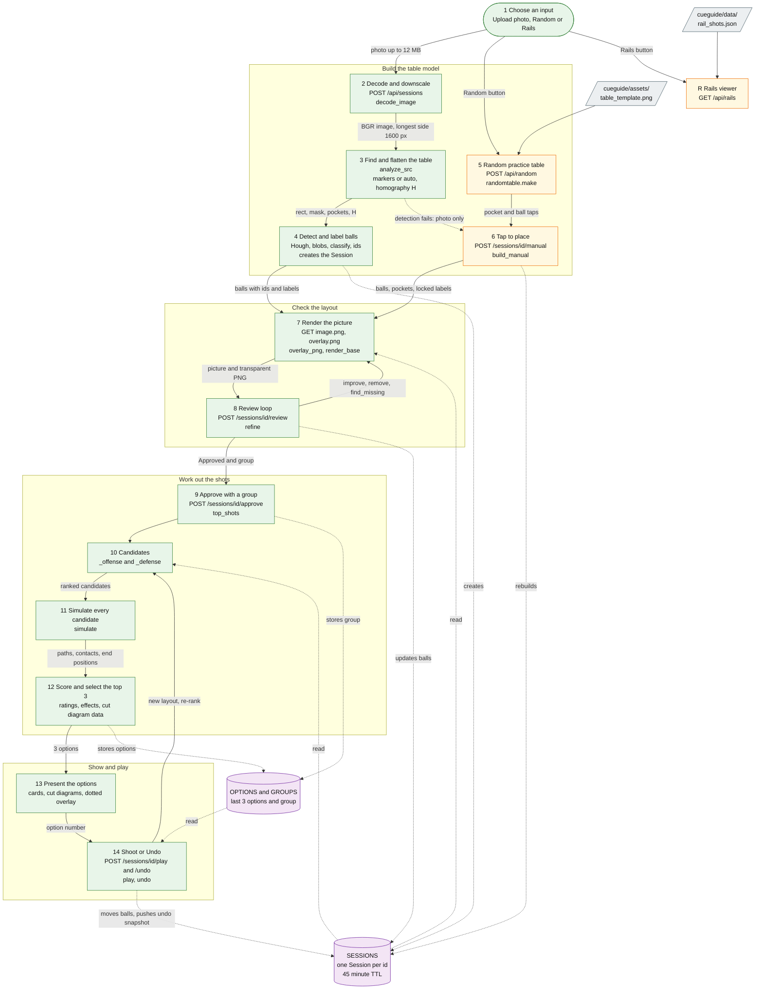

<div align="center">

# 🎱 Pool Cue Guide

**Upload a photo of a pool table (or generate a random one) and get the three best shots, with every ball's movement simulated and drawn.**


</div>

---

## Contents

1. [What it does](#what-it-does)
2. [Quick start](#quick-start)
3. [How to use it](#how-to-use-it)
4. [Dataflow](#dataflow)
5. [Step-by-step: what happens to the data](#step-by-step-what-happens-to-the-data)
6. [API reference](#api-reference)
7. [Data model](#data-model)
8. [Configuration and constants](#configuration-and-constants)
9. [Project structure](#project-structure)
10. [Testing](#testing)
11. [Deployment](#deployment)
12. [Limitations](#limitations)
13. [Sources](#sources)

## What it does

| Capability | Detail |
|---|---|
| **Photo to table model** | Finds the felt, flattens it to a top-down view, detects and labels the balls (cue, 8, solids, stripes). Neon-green pocket markers or a tap-to-place editor give exact results when automatic detection is not enough. |
| **Review loop** | Every ball gets a label. Tick **Improve** (re-detect) or **Remove**, re-run, and repeat until you press **Approved**. |
| **Three best shots** | Offense and defense (safety) candidates are each replayed by a physics simulation, scored and ranked. At least one safety is always included when one exists. Choose Open table, Solids or Stripes at any time. |
| **See every effect** | Dotted lines show where each ball travels, dotted circles where it stops (`IN` = pocketed). A ball-hit diagram shows the exact cut overlap. |
| **Shoot, repeat** | **Shoot** moves the balls to the simulated end positions and ranks three new options. **Undo** steps back. |
| **Random practice table** | A random layout on a template table that you can edit by removing and adding balls. |
| **Rails library** | 17 stored kicks, banks and diamond systems, shown on one large diagram with an explanation. No lookups at runtime. |

## Quick start

```bash
git clone https://github.com/mathcodes/pool-cue-guide.git
cd pool-cue-guide
pip install -r requirements.txt
uvicorn cueguide.app:app --port 8000      # open http://localhost:8000
```

Requirements: Python 3.12 (the Docker image uses `python:3.12-slim`), and the packages in `requirements.txt` (FastAPI, uvicorn, python-multipart, opencv-python-headless, numpy, matplotlib).

## How to use it

1. **Get a table**: upload a top-down photo, press **🎲 Random** for a practice table, or open **📐 Rails** to study rail shots.
2. **Check the balls**: the picture shows each ball's label (B1, B2, ...). If something is wrong, use **Improve** / **Remove** / **Look for missing balls**, or switch to **Tap to place** and tap every pocket and ball yourself.
3. **Choose your group** (Open table, Solids 1-7, Stripes 9-15) and press **Approved**.
4. **Read the three options**: each card shows the rating, summary, where every ball ends up, and a ball-hit diagram. Click a card to see its dotted paths on the table.
5. **Shoot** the one you like. The table updates and three new options appear. **Undo last shot** steps back.

**Tip for the best photos:** cover the six pockets with bright green (neon) discs. Their centres become the table outline, which gives a perspective-correct top-down view even from an angle.

## Dataflow

Green boxes are the main path, orange boxes are alternative entry points, purple cylinders are the in-memory state and grey shapes are stored files. Each box is numbered to match the [step-by-step section](#step-by-step-what-happens-to-the-data) below. A rendered copy is in [`docs/dataflow.svg`](docs/dataflow.svg) and [`docs/dataflow.png`](docs/dataflow.png); the source is [`docs/dataflow.mmd`](docs/dataflow.mmd).



## Step-by-step: what happens to the data

Everything lives in two layers: the browser (`static/index.html`, plain JavaScript) calls a JSON/PNG API (`cueguide/app.py`, FastAPI) that delegates to the engine (`cueguide/engine.py`, built on the original vision script `cueguide/vision.py`). All per-user state is a `Session` object held in memory.

### 1. Choose an input
- **Input:** a click on *Upload photo / Analyze*, *🎲 Random* or *📐 Rails* (header buttons are available on every screen).
- **Processing:** the browser picks the matching API call. The photo (JPG or PNG) is sent as `multipart/form-data`.
- **Output:** one HTTP request (steps 2, 5 or R).
- **Objects:** browser-only state is initialised (`sid`, `st`, the tap points `pts`, the options list `opts`, the group `grp`). Nothing is stored on the server yet.

### 2. Decode and downscale the upload
- **Endpoint / function:** `POST /api/sessions` → `engine.decode_image`.
- **Input:** the uploaded file. The server reads at most 12 MB + 1 byte.
- **Processing:** the bytes are decoded with OpenCV into a BGR image. If the longest side is over 1600 px (`MAX_SIDE`) it is shrunk with area interpolation, so phone photos stay fast.
- **Output:** a NumPy image (`src`).
- **Objects:** none persisted.
- **Failure modes:** over 12 MB gives HTTP 413; an unreadable file gives HTTP 422 with a friendly message.

### 3. Find the table and flatten it
- **Function:** `engine.analyze_src` → `_find_markers` / `_marker_layout`, then `_build_markers` or `_build_auto`, then `vision.warp_to_topdown`.
- **Input:** `src` from step 2.
- **Processing:**
  - **Marker mode:** neon-green discs (HSV hue 40-72, saturation ≥ 130, value ≥ 190) are located. Their centres give the pocket positions; with 4 markers the two side pockets are derived. The outline is grown outward (1.15 × marker radius) so the pockets are fully in view, and shrunk inward (0.5 × marker radius) to define the playing area.
  - **Auto mode** (no usable markers): a hue-based felt mask, a coverage crop and a minimum-area rectangle (or extreme diagonal corners) give the four table corners, padded by 7 %. The inner quad becomes the playing-area mask and pockets are found on the flattened image.
  - A homography `H` warps the photo to a top-down image whose short side is 900 px.
- **Output:** `rect` (top-down BGR image), `table_mask`, `pockets` (6 points), `pocket_r`, `H`, `mode` (`'markers'` or `'auto'`).
- **Objects:** held temporarily; they become fields of the `Session` in step 4.
- **Failure modes:** if the table cannot be found, `create()` does not fail. It builds a *photo-only* session (`mode = 'none'`) with an explanatory message so the user can use **Tap to place** (step 6).

### 4. Detect and label the balls, create the Session
- **Function:** `engine._hough_balls`, `_blob_balls`, `_on_felt`, `_inside_play`, `vision.classify_balls`, `_assign_ids`.
- **Input:** `rect`, `table_mask`, `pockets`.
- **Processing:**
  1. Hough circles on the flattened image; keep those within 0.75-1.3 × the median radius and not inside a pocket.
  2. The felt colour is sampled; a saturation below 35 means "not a pool table" and the analysis stops.
  3. Round blobs that differ from the felt are added for balls Hough missed; balls not sitting on felt or outside the playing area are dropped.
  4. `classify_balls` labels each ball: cue (brightest, neutral colour), eight (darkest), and stripe or solid by the share of near-white pixels.
  5. Stable ids `B1, B2, ...` are assigned.
- **Output:** a list of `Ball` objects → a new `Session` (12-character id) stored in `SESSIONS`; the API returns `_state(session)`: `id, mode, message, pockets, round, width, height, src_width, src_height, history, balls[{id,label,x,y,r}]`.
- **Objects created:** `Session`, `Ball` × n, `history[0] = "initial detection"`.
- **Limits:** at most 20 sessions are kept (the oldest is evicted) and each expires after 45 minutes.

### 5. Random practice table (alternative entry)
- **Endpoint / function:** `POST /api/random` → `randomtable.make` → `engine.photo_session` + `engine.build_manual`.
- **Input:** optional `{"balls": 6-16, "seed": n}`.
- **Processing:** the table image `cueguide/assets/table_template.png` is loaded; a cue ball, the 8-ball and random numbered balls are placed without overlaps and away from the pockets, then drawn as solids or stripes with numbers. Because the positions are known exactly, the six pocket points and every ball become a list of "taps" (`{x, y, kind}`), skipping all detection.
- **Output:** the JPEG, plus the list of taps, which flows into step 6's `build_manual`. The response includes `random: true` and `items` so the Tap editor is pre-filled.
- **Objects created:** `Session` (`mode = 'manual'`, `message = 'random'`) in `SESSIONS`.

### 6. Tap to place (alternative entry and fallback)
- **Endpoint / function:** `POST /api/sessions/{id}/manual` → `engine.build_manual`.
- **Input:** up to 40 items `{x, y, kind}`, with `x, y` in the stored photo's coordinates and `kind` from the dropdown (`pocket1-6`, `cue`, `ball1-15`, `eight`, ...).
- **Processing:** every point must have a label and no label may be used twice. `_layout_from_points` finds the table corners geometrically (the pocket numbering does not matter; at least the four corner pockets are needed, side pockets are derived). The photo is warped as in step 3, ball taps are snapped to the real ball centres by `_local_redetect`, and the labels you chose are locked (`_relabel`) so later review rounds never change them. Ids become `#n` and `CUE`.
- **Output:** a report plus `_state`.
- **Objects modified:** the `Session`'s `rect, table_mask, pockets, pocket_r, H, balls, mode = 'manual'`; any stored options for the session are cleared.
- **Failure modes:** HTTP 422 with a specific message (missing label, duplicate label, too few pockets).

### 7. Render the picture
- **Endpoints / functions:** `GET /api/sessions/{id}/image.png` → `engine.render_base`; `GET .../overlay.png?option=N&pick=B3,B5` → `engine.overlay_png`.
- **Input:** the `Session` (and optionally an option number or highlighted ball ids).
- **Processing:**
  - The base picture is `rect`, or, after a played shot (step 14), the cleaned felt with the balls redrawn.
  - The overlay is a **transparent RGBA PNG** of the same size, so the browser can lay it over the base. It contains faint diamond-to-diamond grid lines (`_draw_diamond_grid`), a straight green outline through the four corner pockets, pocket circles, a ring and label for each ball, and, when an option is selected, its dotted paths (`_draw_option`).
- **Output:** PNG bytes with `Cache-Control: no-store`.
- **Objects:** read-only.

### 8. Review loop
- **Endpoint / function:** `POST /api/sessions/{id}/review` → `engine.refine`.
- **Input:** `{improve: [ids], remove: [ids], find_missing: bool}` (each list up to 40; HTTP 400 if all are empty).
- **Processing:**
  - **Remove:** the ball is deleted and a suppression zone (1.3 × its radius) is recorded so it is not detected again.
  - **Improve:** `_local_redetect` re-fits the ball's centre and radius from the pixels around it.
  - **Look for missing:** `_rescan` searches the felt for extra round blobs.
  - Labels are re-derived (`_relabel`), new balls get new ids while existing ids stay put, and the round counter is incremented.
- **Output:** a report (`removed, improved, unchanged, unknown, added`) plus `_state`; the browser redraws the overlay (back to step 7). Loop until satisfied.
- **Objects modified:** `Session.balls`, `suppressed`, `round`, `next_id`, `history`; stored options are cleared.

### 9. Approve with a group
- **Endpoint / function:** `POST /api/sessions/{id}/approve` → `engine.top_shots`.
- **Input:** `{group: "open" | "solid" | "stripe"}`.
- **Processing:** checks that the table is ready (HTTP 409 otherwise) and that a cue ball exists (HTTP 409 otherwise), then calls `top_shots`. Any unexpected error is logged and returned as a readable HTTP 500 instead of leaving the page spinning.
- **Output:** `_state` plus `approved: true`, `group` and `options` (the three ranked options).
- **Objects modified:** `OPTIONS[id]` and `GROUPS[id]`. Changing the group on the results page calls this endpoint again.

### 10. Build the candidate shots
- **Function:** `engine._offense` and `engine._defense` (inside `top_shots`).
- **Input:** the `Session` and the group.
- **Processing:**
  - If every ball of the group is gone, only the 8-ball is legal (`_group_cleared`).
  - **Offense:** `vision.compute_shots` gives the direct cue → ball → pocket shots with a ghost-ball aiming point and a path score. Combos are skipped, balls that are illegal for the group are skipped, and only the best shot per (ball, pocket) is kept. Cut angle, force, english and draw/follow advice come from `build_physics_summary`.
  - **Defense:** thin hits on a legal ball that send the cue ball where the opponent's balls are hard to reach, scored by blocked opponent lines, distance and rail contact.
- **Output:** two ranked lists of candidate dictionaries (`kind, raw, target, target_label, ball, pocket | object_end, ghost, physics`); the top 8 offense and top 6 defense candidates continue.

### 11. Simulate every candidate
- **Function:** `engine._sim_offense`, `_sim_defense`, `simulate`.
- **Input:** a candidate, the cue direction (cue → ghost point) and a stroke speed.
- **Processing:** the speed is chosen so that the object ball just reaches the pocket (with a 1.35 margin) or its planned stopping place, capped at 22. Offense candidates are tried with follow (+0.35), stun (0) and draw (-0.3) and the best cue-ball finish is kept. The simulator then advances all balls in sub-steps of at most 5 px with rolling friction, ball-ball collisions (restitution 0.96), cushion bounces (0.78) from bounds set by the pockets, and pocket capture. It records each moving ball's path, every first contact, rail counts, which balls were pocketed and whether the cue ball scratched.
- **Output:** a `sim` dictionary: `moves[{id,label,path,start,end,pocketed,pocket,rails}]`, `contacts`, `cue_scratch`, `first`, `ghost`.
- **Objects:** attached to the candidate; no session data changes.

### 12. Score and select the top three
- **Function:** the second half of `engine.top_shots` (`_pos_score`, `_score_defense`, `_effects`, `_cut_info`, `_describe`).
- **Processing:**
  - Offense is kept only if the first contact is the target ball, the target is pocketed and the cue ball does not scratch; illegal pots reduce the score. The cue ball's finishing place (away from rails and pockets) adjusts the score.
  - Defense is dropped on a scratch or illegal pot and is re-scored from the *simulated* final positions.
  - Ratings: offense = 95 × raw / best-offense-raw; defense = 80 × raw / best-defense-raw. The three highest are chosen, and a safety is guaranteed a place if one exists.
  - Each option gets `rank`, `summary`, `effects` (plain-language results such as "Cue ball finishes bottom right" or "B14 is pocketed in the bottom-right corner"), `cut` (`deg`, `side`, `overlap`) and a `legend`. The overlap fraction is exact: centres are 2r·sin(cut) apart, so the hit fraction is 1 − sin(cut) of a diameter (30° = 1/2 ball, 14.5° = 3/4, 48.6° = 1/4).
- **Output:** the list of three option dictionaries, which becomes `options` in the step 9 response.
- **Objects created:** `OPTIONS[id]`.

### 13. Present the options
- **Input:** `options` from step 12.
- **Processing (browser):** one card per option with rank, kind (Pot or Safety), rating, summary, the effects list, a ball-hit SVG diagram and a **Shoot** button. Clicking a card requests `overlay.png?option=N` (step 7) so its dotted lines and dotted end-position circles appear over the table. The group control re-runs step 9. A thin progress bar and a spinner on the clicked button show while the server is working.
- **Output:** what the user sees; no data changes.

### 14. Shoot or Undo
- **Endpoints / functions:** `POST /api/sessions/{id}/play` (`{option: 1..10}`) → `engine.play`; `POST /api/sessions/{id}/undo` → `engine.undo`.
- **Processing:**
  - **Shoot:** the current balls are deep-copied onto an undo stack (`snaps`). On the first shot `_erase_balls` paints the old balls out of the table picture with the local felt colour and stores it as `clean`. Each simulated move is then applied: pocketed balls are removed, the others move to their simulated end positions. `round` and `played` increase and a history line is added. The server immediately re-ranks the new layout with the stored group (back to step 10) and returns the new options, the potted ball ids and a note ("Table cleared." or "No clear shot from here." when relevant).
  - **Undo:** the last snapshot is restored, `played` decreases (the cleaned picture is dropped at zero), and the options are re-ranked.
- **Objects modified:** `Session.balls`, `clean`, `played`, `snaps`, `round`, `history`; `OPTIONS[id]`.
- **Failure modes:** HTTP 409 when there are no options to play or nothing to undo.

### R. Rails library (any time)
- **Endpoint / function:** `GET /api/rails`.
- **Input:** none.
- **Processing:** `cueguide/data/rail_shots.json` is read once at start-up. It holds 17 entries: 7 kicks, 4 banks, 4 systems (mirror, Plus Two, Corner-5, Sixes) and 2 spin/speed notes. The file is generated offline by `python tools/gen_rails.py`, which computes every path by exact equal-angle reflection on an 8 × 4 diamond grid (coordinates in diamonds) and attaches the written explanation and source links.
- **Output:** the JSON. The browser draws one large table diagram (diamond numbers, dotted path, red contact points, pockets) with the explanation, steps, tips and sources; a list and filters pick another shot.
- **Objects:** none; no session is needed and nothing is fetched from the web at runtime.

## API reference

| Method | Path | Body / query | Returns |
|---|---|---|---|
| `POST` | `/api/sessions` | multipart `file` (≤ 12 MB) | session state (auto detection, or photo-only if it fails) |
| `POST` | `/api/random` | `{balls?: 6-16, seed?}` | session state + `random: true` + `items` |
| `GET` | `/api/sessions/{id}` | | session state |
| `GET` | `/api/sessions/{id}/image.png` | | base picture (photo view or redrawn table) |
| `GET` | `/api/sessions/{id}/overlay.png` | `option`, `pick` | transparent overlay PNG |
| `GET` | `/api/sessions/{id}/photo.jpg` | | the stored (downscaled) original |
| `GET` | `/api/sessions/{id}/prefill` | | tap items made from the current balls and pockets |
| `POST` | `/api/sessions/{id}/manual` | `{items: [{x, y, kind}]}` | report + state |
| `POST` | `/api/sessions/{id}/review` | `{improve, remove, find_missing}` | report + state |
| `POST` | `/api/sessions/{id}/approve` | `{group}` | state + `options` |
| `POST` | `/api/sessions/{id}/play` | `{option}` | state + `options` + `report` + `played` |
| `POST` | `/api/sessions/{id}/undo` | | state + `options` |
| `GET` | `/api/rails` | | stored rail-shot library |
| `GET` | `/healthz` | | `{"ok": true}` |

Errors are JSON `{"detail": "..."}` with 400 (bad request), 404 (session expired), 409 (not ready), 413 (too large), 422 (unreadable or invalid input) or 500 (shot calculation failed).

## Data model

| Object | Where | Key fields |
|---|---|---|
| `Session` | `engine.py` | `id, mode (markers/auto/manual/none), rect, table_mask, pockets, pocket_r, H, balls, suppressed, round, history, src_jpg, src_size, clean, played, snaps` |
| `Ball` | `vision.py` | `center (x, y), radius, mean_bgr, label (cue/eight/solid/stripe/unknown), id` |
| Option | `top_shots` result | `rank, kind (offense/defense), rating, summary, target, target_label, ghost, pocket or object_end, physics, spin, speed, sim, effects, cut, legend` |
| `sim` | `simulate` result | `moves[{id, label, path, start, end, pocketed, pocket, rails}], contacts, cue_scratch, first, ghost` |
| Server state | `app.py` | `SESSIONS` (id → Session), `OPTIONS` (id → last options), `GROUPS` (id → group) |

All coordinates are in the flattened top-down image (`rect`) unless noted. Tap coordinates are in the stored photo (≤ 1600 px wide).

## Configuration and constants

| Constant | Value | Where |
|---|---|---|
| Upload limit | 12 MB | `app.MAX_UPLOAD` |
| Photo downscale | longest side 1600 px | `engine.MAX_SIDE` |
| Flattened table | short side 900 px | `warp_to_topdown(target_short=900)` |
| Sessions kept / lifetime | 20 / 45 min | `app.MAX_SESSIONS`, `app.TTL` |
| Green marker colour | HSV hue 40-72, S ≥ 130, V ≥ 190 | `_find_markers` |
| Rolling deceleration | 0.06 px/step² | `A_ROLL` |
| Ball / cushion restitution | 0.96 / 0.78 | `E_BALL`, `E_RAIL` |
| Maximum stroke speed | 22 | `V_MAX` |
| Cue-ball spin options | follow +0.35, stun 0, draw -0.3 | `_sim_offense` |

Environment: the container reads `$PORT` (default 8000). Run a single worker, because sessions live in memory.

## Project structure

```
pool-cue-guide/
├── cueguide/
│   ├── app.py            FastAPI routes, in-memory session store
│   ├── engine.py         table finding, ball detection, review, overlay, simulation, ranking
│   ├── vision.py         original vision and shot-physics script (warp, classify, compute_shots)
│   ├── randomtable.py    random practice table generator
│   ├── assets/           table_template.png
│   └── data/             rail_shots.json (generated)
├── static/index.html     the whole front end (no build step)
├── tools/gen_rails.py    builds rail_shots.json by exact reflection geometry
├── docs/                 dataflow.mmd / .svg / .png
├── tests/                test_api.py, stress.py, e2e.js, fixtures/
├── Dockerfile  railway.json  requirements.txt
```

## Testing

```bash
python -m pytest -q                 # 15 API and engine tests
python tests/stress.py 40           # 40 random tables: rank, shoot and undo in every group, no errors
node tests/e2e.js                   # Playwright browser run (start the server on :8021 first)
```

The browser run covers Random, Approve, switching group, Shoot three times, Undo, Back, tap-edit, the Rails viewer, photo upload, the progress bar and the pressed-button styling.

## Deployment

The repo is ready for [Railway](https://railway.com): connect it and the `Dockerfile` and `railway.json` are used (health check `/healthz`). The start command is
`uvicorn cueguide.app:app --host 0.0.0.0 --port ${PORT:-8000} --workers 1`. If the app answers "Application failed to respond", make sure the service's target port matches `$PORT`.

## Limitations

- Automatic detection is heuristic (felt colour, Hough circles, colour blobs). It works best on top-down photos; use green pocket markers or **Tap to place** for angled or unusual tables.
- Solid/stripe classification from colour can mislabel balls; labelling them yourself in **Tap to place** fixes this.
- The physics uses estimated constants, and ratings, speed and spin are estimates. Treat paths as a guide, not a guarantee.
- Sessions are held in memory and are lost on restart or after 45 minutes.
- The Corner-5, Plus Two and Sixes cards are written summaries of the cited sources (numbering conventions differ between sources) and have no drawn path.

## Sources

Rail and diamond-system material is summarised from [Dr. Dave Pool Info: diamond systems](https://drdavepoolinfo.com/faq/bank-kick/diamond-systems/), [Dr. Dave: Corner-5](https://drdavepoolinfo.com/faq/bank-kick/corner-5/), [Liberty Games](https://www.libertygames.co.uk/pool-diamond-system/) and [PoolDawg](https://www.pooldawg.com/article/how-to-make-kick-bank-shots/). The ball-hit diagram follows the style of the "Ball-Hit Fractions" figure on drdavepoolinfo.com.
